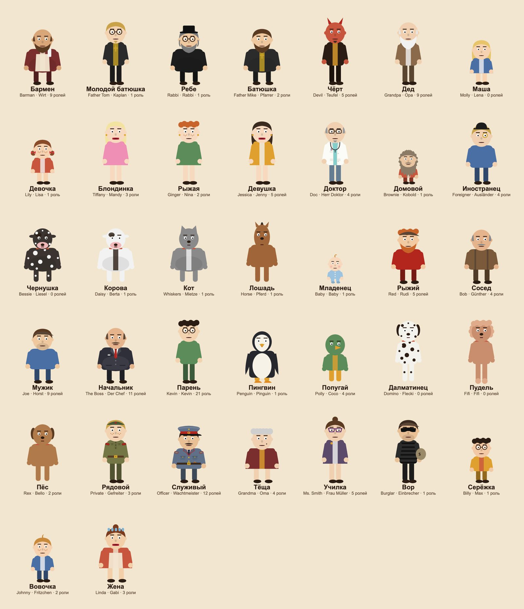
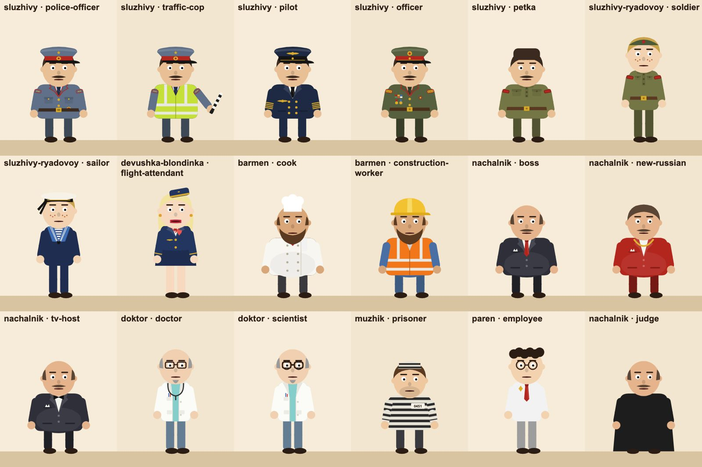
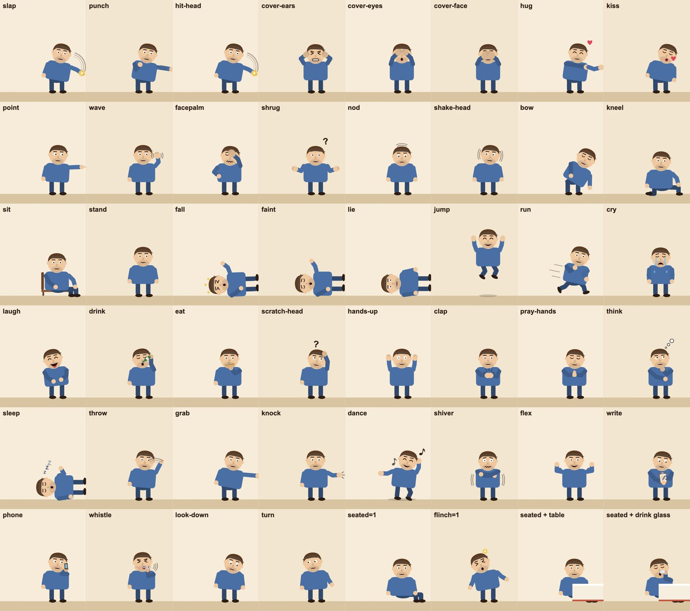
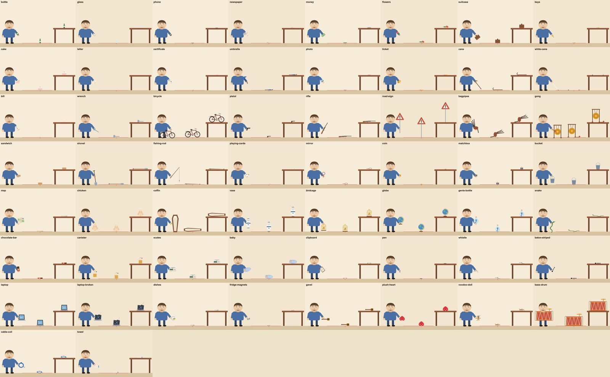
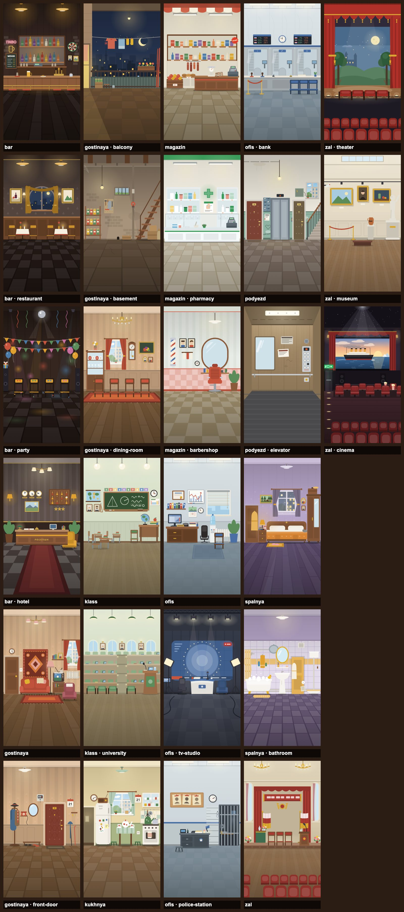
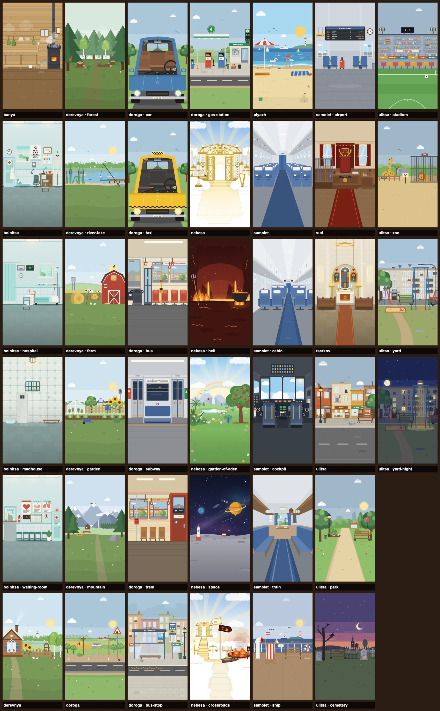
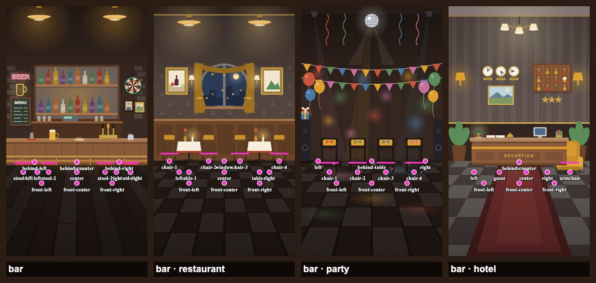
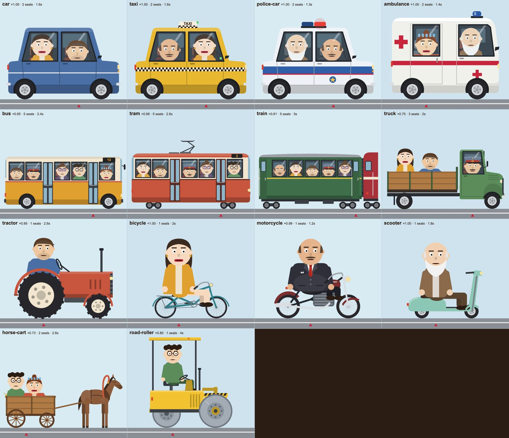

# ANEK. — фабрика анекдотов

Короткие вертикальные видео по анекдотам на русском, английском и немецком: векторные куклы, нарисованные кодом, закадровый смех и музыка (CC0), озвучка (ElevenLabs или ComfyUI на сервере, в планах), субтитры-караоке, монтаж в Remotion, публикация через Postiz, база публикаций и метрик в Postgres.

- База: 6000 популярных анекдотов (по 2000 на язык) с разметкой: персонажи, локации, переводимость, флаги.
- Каст: 37 кукол (с двойниками, формой и костюмами под роли), 19 мест и 68 комнат (сублокаций) с глубиной, сиденьями, стойками и мебелью, 14 видов транспорта, 58 предметов. Надписи в фонах — на языке ролика.
- Сценарии: LLM-стадия пишет и адаптирует сценарии дословно по источнику, движок ставит их сам (действия, глубина, комнаты, машины) → `content/episodes/` (1800 эпизодов; переписываются кругами, см. [docs/ENGINE.md](docs/ENGINE.md)).
- База `anek-db` (Postgres, `packages/db`): анекдоты, ассеты, эпизоды, рендеры, публикации, метрики. Публикация — Postiz ([docs/POSTIZ.md](docs/POSTIZ.md)).

Подробности: [docs/ARCHITECTURE.md](docs/ARCHITECTURE.md), движок постановки: [docs/ENGINE.md](docs/ENGINE.md), цифры по базе: [docs/catalog-report.md](docs/catalog-report.md).

## Как это выглядит
Всё нарисовано кодом (SVG в `remotion/src`). Листы пересобираются командами из раздела «Превью» ниже.

**Куклы** (`content/characters`, риг `remotion/src/puppet`):



**Роли и форма** — роль сама одевает куклу (пилот, полиция, ГАИ, военные, повар, строитель, стюардесса, начальник, врач, заключённый, моряк):



**Действия** — куклы отыгрывают сказанное рассказчиком (подзатыльник, закрыть уши, сесть, упасть, пишет, звонит, свистит…):



**Предметы** — в руке и положенные на стол (`content/props.json`, рисунок `remotion/src/props/Props.tsx`):



**Места и комнаты** — дом, бар, магазин, офис, школа, зал:



…больница, самолёт, дорога и транспорт внутри, улица, деревня, небеса, церковь, суд, баня, пляж:



**Как устроено место** — бар и его комнаты с метками: кружок — где стоит кукла (ниже — ближе к камере), розовая полоса — сиденье, на котором кукла сидит сама; стойка — передний слой, бармен за ней:



**Транспорт снаружи** — седоки в окнах или верхом:



### Превью (пересобрать картинки)
```bash
cd remotion
npx remotion still src/index.ts Cast out.png
npx remotion still src/index.ts Outfits out.png --props='{"mode":"roles"}'
npx remotion still src/index.ts Acts out.png --props='{"who":"muzhik"}'
npx remotion still src/index.ts Locations out.png --props='{"only":["bar"],"marks":true,"locale":"en"}'
npx remotion still src/index.ts Vehicles out.png
npx remotion still src/index.ts Props out.png
npx remotion still src/index.ts Joke out.png --props=../content/episodes/<id>.json --frame=120
```

## Озвучка (второй компьютер, платный ElevenLabs)
Полная инструкция: [docs/VOICE-HANDOFF.md](docs/VOICE-HANDOFF.md). Коротко:
```bash
git clone git@github.com:svetlanasava16/videogen.git && cd videogen && git checkout joke-factory-pipeline
pnpm install
# .env: ELEVENLABS_API_KEY=<ключ>  и  ELEVENLABS_PLAN=paid
pnpm voice apply-casting --locale ru          # один раз: голоса из docs/CASTING.md
pnpm voice run --compilation ru-20261121-01,ru-20261121-02,ru-20261122-01          # смета
pnpm voice run --compilation ru-20261121-01,ru-20261121-02,ru-20261122-01 --yes    # озвучка
pnpm voice check
git add content/episodes remotion/public/audio/voice content/characters content/voices.json
git commit -m "Voice: ru" && git push
```
База и готовые ролики для озвучки не нужны: озвучка уходит через git, на Маке Мити — `git pull` и `pnpm render --compilation <id>`. Тестовая озвучка с бесплатного аккаунта на платном ключе переозвучивается сама.

## Установка
Нужны Node.js 22+, pnpm, Docker и Git LFS (эталонные кадры и озвучка лежат в LFS).
```bash
brew install git-lfs && git lfs install --local && git lfs pull
pnpm install
pnpm typecheck
docker compose -f infra/docker-compose.yml up -d anek-db   # база проекта
pnpm db migrate && pnpm db sync
```
Сырые датасеты в git не лежат. Перекачать их можно командой `pnpm jokes ingest`, но для работы со сценариями и куклами они не нужны: база и разметка уже в `data/`.

## Главные команды
```bash
pnpm studio                                   # Remotion Studio: смотреть эпизоды, Cast, Locations
pnpm validate [--debug]                       # проверка эпизодов по схеме и ссылкам
pnpm stills <id>|--debug                      # ключевые кадры и контактный лист → out/stills/
pnpm golden [--update]                        # эталонные кадры отладочного набора (перед коммитом в движок)
pnpm catalog                                  # пересчитать отчёт docs/catalog-report.md
pnpm registry                                 # после правок content/characters или content/locations
pnpm llm prepare|check|collect|status <stage> # LLM-стадии пачками (analyze, script)
pnpm llm materialize script                   # сценарии → content/episodes/
pnpm audio add <file> --kind laugh|music …    # звук (CC0) → remotion/public/audio + content/audio.json
pnpm db sync | status | dump                  # контент из git → база; счётчики; бэкап
pnpm voice cast|search|assign|preview|run|check # озвучка ElevenLabs (компьютер с ключом)
pnpm render --voiced --top 20 --locale ru     # рендер + обложка в renders/, учёт в базе
pnpm board                                    # страница для постинга с телефона
pnpm posts plan|push|sync|list                # публикация через Postiz
pnpm metrics pull|report                      # метрики → база, docs/metrics-report.md
```

## Кто что делает (сейчас: Instagram вручную, ru и en)
| Шаг | Где | Команды |
|---|---|---|
| Озвучка ElevenLabs (платный план, ключ в `.env`) | компьютер девушки | `pnpm voice cast/search/assign/preview`, `pnpm voice run --locale ru --top 30 --yes`, commit + push |
| Рендер, план, страница для телефона | Мак Мити | `git pull`, `pnpm db sync`, `pnpm render --voiced …`, `pnpm posts plan --account ig-ru …`, `pnpm board` |
| Публикация | телефон | ссылка из `pnpm board`: скачать видео, скопировать подпись, Reel с меткой ИИ, «Опубликовано» |

Подписи всегда заканчиваются маркировкой и правами: голос — ИИ, видео — ANEK., персонажи вымышлены, © 2026 ANEK. (`content/disclosure.json`).

## Работа с Claude Code
Проект рассчитан на работу через Claude Code. Скиллы лежат в `.claude/skills/` и подхватываются автоматически в любой сессии Claude Code, открытой в этой папке (после `git pull`, ничего ставить не нужно). Вызвать скилл можно явно (`/jokes-scripts`) или просто описать задачу словами, и Claude выберет нужный.

| Скилл | Когда | Пример запроса |
|---|---|---|
| `llm-batch-run` | любая массовая LLM-задача пачками с сабагентами | «прогони стадию analyze на новых анекдотах» |
| `jokes-annotate` | база анекдотов, разметка, отчёт | «пересобери каталог и покажи топ персонажей» |
| `jokes-classify` | новая метка или классификация | «размечь анекдоты по праздникам» |
| `jokes-cast` | куклы, двойники, костюмы, фоны, покрытие | «добавь двойника для Начальника», «нужна кукла медведя» |
| `jokes-draw` | рисование кодом: риг, позы, лица, аксессуары, фоны | «дай бармену усы и полотенце», «нарисуй баню» |
| `jokes-scripts` | сценарии, переводы, адаптации, превью | «напиши сценарии для следующих 50 немецких анекдотов» |
| `jokes-sources` | новые источники и языки | «добавь польские анекдоты» |
| `jokes-engine` | движок: сцены, камера, городок, сборники, новые места без кода | «сделай сборник из трёх анекдотов», «добавь в город тюрьму» |
| `jokes-voice` | озвучка ElevenLabs: кастинг голосов, смета, генерация, передача через git | «подбери голоса для русских кукол», «озвучь сборник ru-20261122-01» |
| `jokes-publish` | рендер, ручной постинг в Instagram, Postiz, база, метрики | «отрендерь топ-20 немецких и запланируй на YouTube на неделю», «сколько лайков у вчерашних постов» |

Общие правила для агента — в [CLAUDE.md](CLAUDE.md): LLM-шаги не ходят в API (их выполняют сабагенты), промпты на английском, обсуждение на русском, арт только кодом, маркировка ИИ в каждой публикации.

## Правила работы с git
- Работаем в ветках, в `main` не коммитим напрямую; сливаем через PR.
- Перед большими LLM-прогонами согласуйте объём: они расходуют много токенов (пачка из 50 разметок ≈ 150 тыс., из 20 сценариев ≈ 150 тыс.).
- Не удаляйте `data/llm/**/*.out.jsonl`: это источник правды для разметки и сценариев (`results.jsonl` собирается из них).
