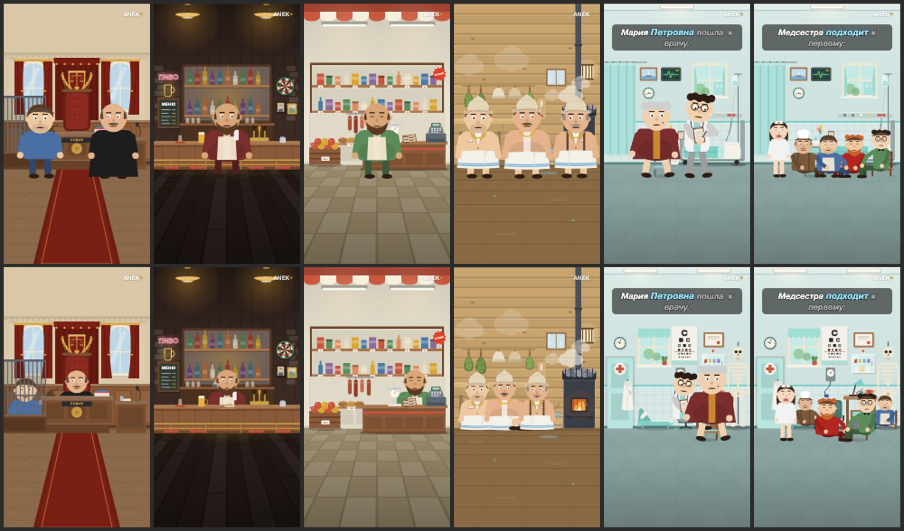
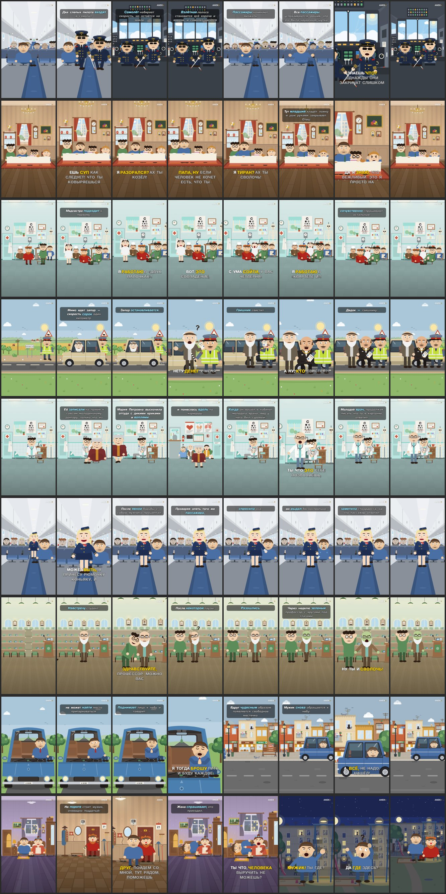
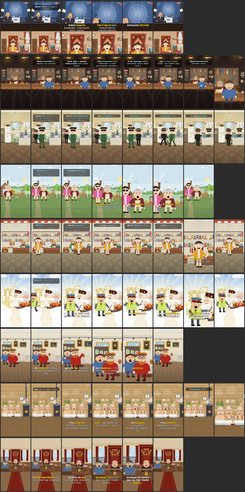

# Этап 1: обратная связь — отчёт

План: [docs/ROADMAP.md](../../ROADMAP.md), §1.

## Что сделано
- **`content/debug-set.json`** — отладочный набор: 18 эпизодов из трёх сборников (`ru-20261121-01`, `ru-20261121-02`, `ru-20261122-01`).
- **`pnpm validate [--debug] [<id>…] [--json]`** (`pipeline/src/validate.ts`) — схема и ссылки по всем эпизодам: места, сублокации, куклы, роли, метки, реквизит, машины и седоки, реплики в сценах, файлы озвучки.
  - **error** — сломается;
  - **warn** — сработает не так, как задумано;
  - **info** — костюм роли взят у куклы-хозяйки.
- **Категории ролей** (`packages/core`):
  - `GENERIC_ROLES` — обычный мужик, покупатель, жена, ребёнок, пациент…; их играет любая кукла, без предупреждений;
  - `APPEARANCE_ROLES` — блондинка, рыжая; внешность нельзя одолжить костюмом: нужна кукла-хозяйка или `looks.hair`, иначе ошибка;
  - остальные роли чужой куклы берут костюм у хозяйки (`remotion/src/puppet/costume.ts`).
- **`pnpm stills <id>… | --debug`** (`pipeline/src/stills.ts`, `stillkit.ts`):
  - кадры на ключевых моментах: начало сцены, каждая реплика, панчлайн, входы и уходы, положил/отдал предмет, машина приехала, последний кадр;
  - `out/stills/<id>/sheet.png` (контактный лист), `index.html` (кадры с подписями), `frames.json`;
  - один бандл Remotion и один браузер на прогон; `STILLS_DEV=1` — сборка React в режиме разработки, чтобы предупреждения React в логе были читаемы.
- **`pnpm golden [--update] [<id>…]`** (`pipeline/src/golden.ts`):
  - эталонные кадры `tests/golden/<id>/` (масштаб 0,15, 323 кадра, 11 МБ);
  - сравнение пикселей (pixelmatch), кадр считается изменённым, если отличается больше 0,5 % пикселей;
  - отчёт `out/golden/report.md`, диффы `out/golden/<id>/f<frame>-diff.png`.
- **Данные транспорта** (`world/vehicleSpecs.ts`) отделены от рисунка: таймлайн больше не тянет React. Это задел под `packages/player`.

## Проверка инструментов на себе
Golden поймал обе исправленные ошибки, E1 и E2 (ниже): после правок изменились первые кадры почти всех 18 эпизодов, а также все кадры двух эпизодов, где поменялась комната. Сверху — до, снизу — после:

## Найденные ошибки и что с ними
| # | Ошибка | Где | Статус |
|---|---|---|---|
| E1 | В начале каждой сцены (~0,3 с, до первой реплики) куклы стоят в автослотах и только потом встают на метки. Отсюда «подсудимый перед решёткой», бармен и продавец перед стойкой, банщики стоят | все сцены с начальной расстановкой | **исправлено**: расстановка с первого кадра сцены |
| E2 | Регрессия прошлого коммита: сцена без `place` брала `place` эпизода из разметки («hospital» → палата вместо кабинета, «car» → салон вместо дороги). Затронуты 872 сцены | «Икота», роддом и др. | **исправлено**: откат, сцена без `place` = вид по умолчанию |
| E3 | 18 сценариев ссылались на метки автобуса, которых больше нет (`car`, `roadside`) | 4 анекдота × 3 языка в `doroga:bus` | **исправлено** в данных: `driver`, `seat-2` |
| E4 | «Блондинку» играли куклы с другими волосами (анекдот про четырёх блондинок) | `de-witze-1rgzohf` × 3 | **исправлено**: `looks.hair` светлый; validate принимает внешность из `looks` |
| E5 | Бармен за стойкой частично закрыт посетителем: оба на x = 0,5, на разных планах | «Сдача» | закрыта на этапе 3: лицо бармена видно, гость стоит сбоку ([отчёт](../stage-3/README.md)) |
| E6 | Двое, лежащие на одной кровати, перекрываются: лежащее тело длиннее места на кровати | «Толкнуть» | открыта: этап 3 (места для лёжа) |
| E7 | Роддом поставлен в кабинете врача, а не в комнате ожидания (старый пилотный сценарий) | `de-witze-1s5wyg5` | открыта: перепишется в следующем круге сценариев |
| E8 | У университета нет коридора («по коридору ВУЗа идёт профессор» — в аудитории) | «Борода» | открыта: новая сублокация `klass:corridor` |
| E9 | В одном прогоне golden браузер написал 56 пустых сообщений React (production-сборка) на эпизоде «Перекрёсток». В режиме разработки не воспроизводится | — | не подтверждено; при повторе смотреть с `STILLS_DEV=1` |

**`pnpm validate` по всем 1 803 эпизодам:** 0 ошибок.
- Предупреждения:
  - 757 — старый формат без `scenes` (переводится на этапе 2);
  - 184 — `place` эпизода из разметки не совпадает с комнатами места (показывается вид по умолчанию; поле уберётся при миграции).
- Info: 174 — костюм роли взят у хозяйки.
- `test-scenes.ru.json`: barmen есть в cast второй сцены, верхний cast по правилу повторяет первую сцену — не ошибка.

## Стоп-кадры отладочного набора (после исправлений)
По строке на эпизод, 8 ключевых кадров.

## Порядок работы дальше
Перед каждым коммитом в движок: `pnpm typecheck`, `pnpm validate`, `pnpm golden`. После намеренного изменения картинки: посмотреть диффы, затем `pnpm golden --update`.
