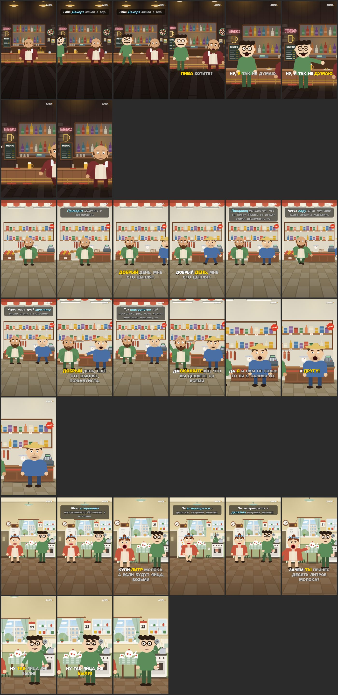

# Этап 2: замороженный формат эпизода — отчёт

План: [docs/ROADMAP.md](../../ROADMAP.md), §2. Формат: [docs/ENGINE.md](../../ENGINE.md), §1.

## Сделано
- **Перед этапом:**
  - шрифт Inter вшит;
  - CI (typecheck, validate, golden);
  - Git LFS для эталонных кадров и озвучки;
  - в отладочном наборе 24 эпизода (+3 en, +3 de);
  - у «Три кнопки и три унитаза» флаги `political`, `real-person`: не публикуется и не попадает в автосборники.
- **Схема `Episode` v2** (`packages/core`) заморожена:
  - `scenes` обязательны;
  - реплики — только речь, без `enter`/`exit`;
  - `looks`, `crowd`, `set` — только в сценах;
  - новые поля `kind` (joke; meme и bridge зарезервированы) и `v: 2`;
  - верхний уровень (`location`, `cast`, `roles`) — сводка сцен;
  - `place` — архетип из разметки, только метаданные.

  Дальше схема только расширяется необязательными полями.
- **Миграция без LLM:** `migrateEpisodeData` в core, команда `pnpm migrate-episodes`.
  - Переведены все 1 805 эпизодов: 757 были без сцен, у 314 стояли `enter`/`exit` на репликах.
  - Комната из старого `place` сохраняется, только если это настоящая сублокация (так оказалось в 152 эпизодах). В остальных 558 — вид по умолчанию, как и рисовалось раньше.
  - Вход и уход стали битами `move`: `from`/`to: off-left|off-right`, плюс новое `to: "auto"` — автослот.
  - Миграция идемпотентна: повторный запуск ничего не меняет.
  - `pnpm llm materialize script` собирает те же файлы байт в байт: сценарии и эпизоды проходят один и тот же перевод.
- **Удалены legacy-ветки:**
  - чтение `enter`/`exit` в таймлайне;
  - `stagingProblems`;
  - сборка сцены из старых полей в `scenesOf`;
  - старые поля в обложке и в подсчёте смеха в озвучке.

  `validate` отвергает файлы старого формата и подсказывает команду миграции.
- **Промпт сценариста:** `scenes` обязательны, входы и уходы — биты `move`.

## Golden: единая среда
- **Проблема.** После вшивания шрифта переносы строк на Маке и в Linux совпали, но края букв различаются: Chrome растеризует текст на macOS и Linux по-разному. В первом прогоне CI все 24 эпизода отличались на 0,5–2,7 % пикселей. Такой шум неотличим от настоящей замены шрифта, поэтому порогом его не убрать.
- **Решение.** Эталоны снимаются только в контейнере `tests/golden-env` (Debian, Node 22, Chrome Headless Shell от Remotion):
  - локально — `pnpm golden:docker [--update]`, на Маке нативно (arm64), около 10 минут на 24 эпизода;
  - в CI — тот же контейнер на amd64.
- **Проверка.** Эталоны сняты на amd64. Нативный arm64-прогон дал 24 из 24 совпадений с ними. **CI на GitHub (amd64) зелёный**: typecheck, validate, golden — 24 из 24 совпали (run 45010097117).
- **Изменения кадров при миграции.** Изменился только `de-witze-1lo14k2.de`: единственный эпизод отладочного набора с `enter`/`exit` на репликах. Уход в нём теперь начинается вместе со следующей репликой, а не сразу после своей. Остальные 23 эпизода совпали с прежними эталонами.

## Мигрированные старые эпизоды (стоп-кадры)
«Декарт в баре», «Цыплята», «Молоко и яйца» — раньше были без сцен, со входами и уходами на репликах. Теперь это одна сцена с битами `move`: персонаж входит из-за края в автослот и уходит за край.

## Что дальше видно по кадрам (не ошибки миграции)
- В старых эпизодах нет меток: бармен стоит в автослоте перед стойкой, а не за ней. Это исправится, когда эпизоды перепишут по новым правилам (круги сценариев).
- Длинные паузы `pauseAfterSec` из старых сценариев сохранены как есть.
