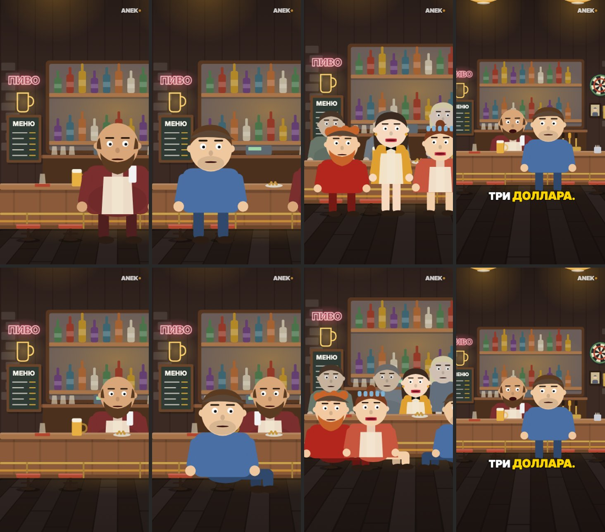
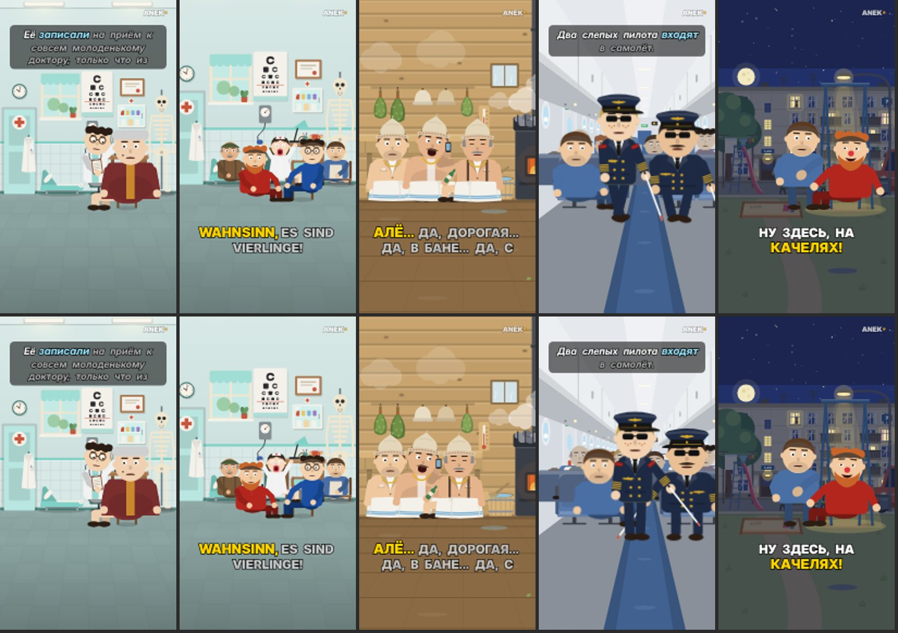

# Этап 3: бар — эталонная локация. Отчёт

План: [docs/ROADMAP.md](../../ROADMAP.md), §3. Правила: [docs/ENGINE.md](../../ENGINE.md), §6б.

## Сделано
- **Слоты места** (`slots` в `content/locations/<id>.json`, у места и у каждой сублокации): упорядоченный список меток, куда встают куклы без своей метки.
  - Сначала слот по роли: бармен или официант — `behind-counter`, за стойкой.
  - Потом свободные слоты по порядку: гости на табуреты от центра (2, 3, 1, 4), затем передние метки.
  - Слот — обычная метка: план глубины, сиденье (кукла садится сама), передний слой.
  - Явная метка в сценарии важнее слота. Чужая явная метка считается занятой.
- **Раздвижка с учётом сидений** (`layout` в `remotion/src/Joke.tsx`):
  - сидящий на метке-сиденье почти не сдвигается: идущий уступает ему в пропорции 1 : 0,15;
  - соседи на одной скамье или в одном ряду кресел сидят рядом;
  - куклы на разных планах расходятся настолько, чтобы лицо дальнего было видно.
- **Бар заполнен:** база, `hotel` (портье за стойкой регистрации), `restaurant`, `party`.
- **Документация:**
  - ENGINE.md §6б (слоты и раздвижка);
  - шаблон «Reference location: the bar» в скилле `jokes-draw`: 7 пунктов — слои, метки на трёх планах, сиденья, поверхности, слоты, надписи, проверочные кадры;
  - промпт сценариста: `"to": "auto"` берёт слот по роли.

## Бар: до и после
Сверху — этап 2, снизу — этап 3. Это старые эпизоды без меток, сценарии не переписывались:
- «Декарт в баре»;
- `de-witze-1bkh9jl.ru`;
- `en-d-12852.ru`;
- «Сдача» (E5).

В первых трёх бармен теперь за стойкой, гости сидят на табуретах. В «Сдаче» метки стоят явно, кадр не изменился: лицо бармена видно, гость стоит сбоку. E5 закрыт.

Всего в базе 174 сцены в баре без меток. Они исправились без переписывания сценариев.

## Отладочный набор: что ещё изменилось
Раздвижка общая для всех мест, поэтому сдвинулись и другие сцены. Изменились 9 из 24 эпизодов: больница (кабинет и роддом), баня, самолёт, детская площадка. Сверху — прежние эталоны, снизу — новые.
- Врач больше не заходит за пациента.
- В роддоме медсестру не зажимает между сидящими.
- Пилоты в проходе не наезжают на пассажира.

## Проверка
- `pnpm typecheck` — без ошибок.
- `pnpm validate` — 1 805 эпизодов, 0 ошибок, 0 предупреждений.
- `pnpm golden:docker --update` в контейнере (arm64): новые эталоны сняты для 9 изменённых эпизодов.
  - Кадры, которые отличаются только шумом рендера (разница канала не больше 15 из 255), сохранили прежние эталоны.
  - Остальные 15 эпизодов совпали.
- CI на amd64 проверит эталоны после push.

## Открыто (дальше)
- E6: двое лежат на одной кровати и перекрываются — нужны места для лёжа (этап 4).
- E7, E8 — в следующих кругах сценариев и сублокаций.
- Остальные места переводятся на слоты по шаблону бара — этап 4.
