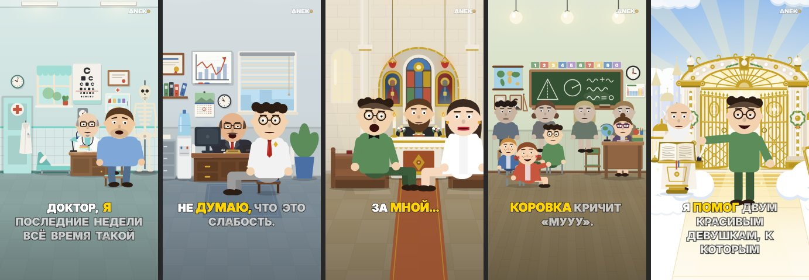
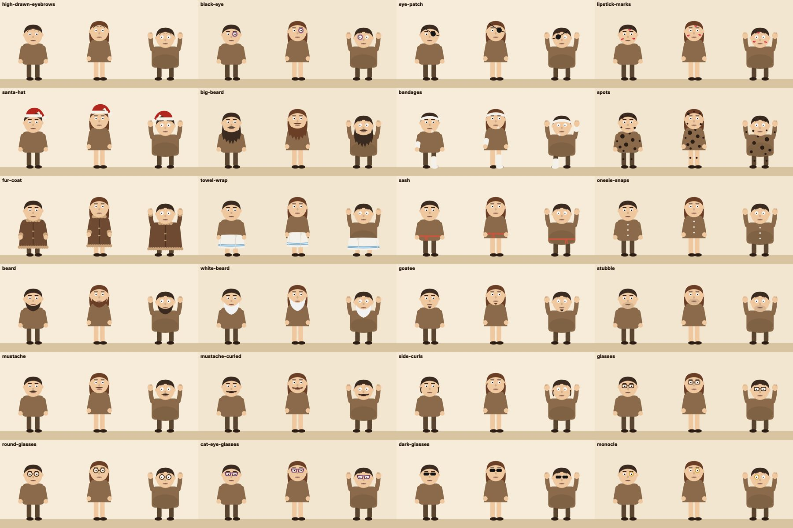
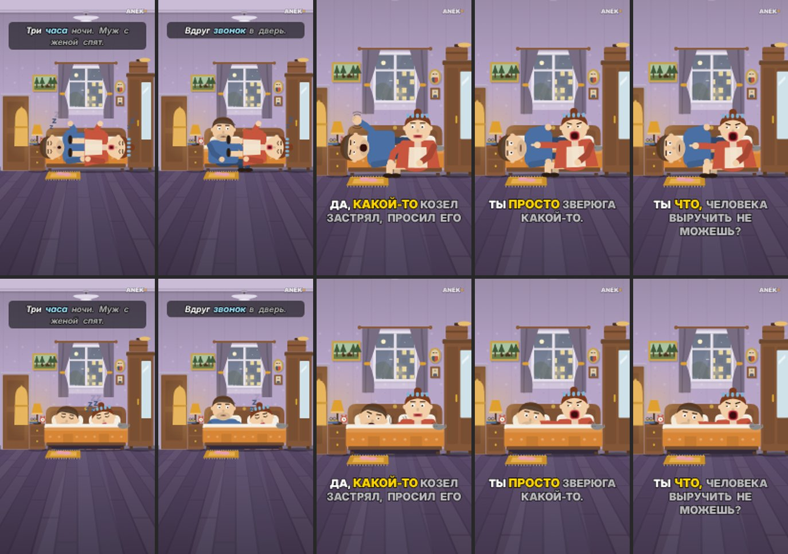
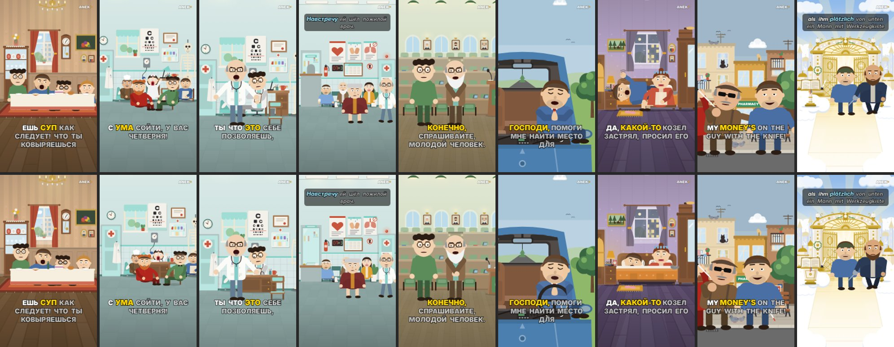

# Этап 4: все места на шаблоне бара, кукла через данные. Отчёт

План: [docs/ROADMAP.md](../../ROADMAP.md), §4. Справочник: [docs/ENGINE.md](../../ENGINE.md), §6б (слоты), §7 (сиденья и кровать), §8а (гардероб).

## Сделано
### 4a. Арт без Remotion
Риг куклы и массовка получают время пропсом `t` (секунды), а не через `useCurrentFrame`. `frameAt(t)` округляет `t·FPS`, поэтому формулы анимации видят те же целые кадры. Golden: 24 из 24 без изменений. Нужно для будущего плеера (этап 7).

### 4b. Все места по шаблону бара
Четыре сабагента параллельно, у каждого свои файлы.
- **Слоты** у всех 19 мест и всех сублокаций: сначала место по роли, потом сиденья от центра, потом передние метки.
  - Врач — за стол, пациент — на стул пациента.
  - Начальник — за стол, секретарь — рядом.
  - Учитель — за учительский стол, профессор — за кафедру, священник — за алтарь, апостол Пётр — за кафедру у ворот, судья — за судейский стол.
  - Водитель — за руль, пилоты — в кресла кабины, продавец и аптекарь — за прилавок.
- **Передние слои и поверхности:**
  - стол врача и стол начальника;
  - окно регистратуры, стол телестудии;
  - учительский стол, кафедра университета, алтарь;
  - кафедра у райских ворот, кафедра зала;
  - приборная панель и руль машины.

  У магазина, аптеки, полиции, банка и суда передний слой уже был: проверен, добавлены слоты.
- **Метки на трёх планах** везде. Сублокации без меток (лес, река, ферма, огород, горы, ад, Эдем, космос) получили полный набор. Новые сиденья:
  - пень и бревно в лесу, табурет рыбака;
  - скамейка у забора в деревне, шезлонг на пляже, кресло парикмахера.
- Существующие метки не переименованы. Сдвинута одна: `nebesa:lectern` — теперь за кафедрой, а не перед ней.

### 4c. Гардероб — данные
- Причёски, аксессуары, головные уборы и форма переехали из `Accessories.tsx` в `content/wardrobe/*.json`. Это 99 вещей и 10 причёсок.
- **Слот крепления:** head-back, hair, face, head, hat, torso, hand, rig.
- **Рисунок** собирается из примитивов (`path`, `rect`, `each`, `lapels`, `buttons`, `belt`, `peaked-cap`…). Размеры — выражения над телом текущего телосложения (`top + h * 0.42`).
- **Форма на руках и ногах:** `outfit` (рукава, брюки, нашивки, погоны). Эффекты рига: `rig` (ряса, крюк, гипс, мех, помада, простыня).
- **Код** — только библиотека примитивов и вычислитель выражений. Удалены списки `FRONT`, `BACK`, `OVER`, `BOTH`, `HAND`, `RIG`, `ROBES`, `LAYER`, `OUTFIT` и большой `switch` по id. Чужую форму роли (`costumeFor`) теперь тоже определяют данные: шапки — слот `hat`, форма — `wear`.
- **Проверка без единого пикселя разницы:** новый лист `Outfits --props='{"mode":"wardrobe"}'` (каждая вещь на трёх телах), листы формы, ролей, Cast, Acts, Props — до и после совпали **пиксель в пиксель**.
- **`validate`** теперь ловит неизвестную вещь или причёску у куклы, в роли или в эпизоде. Таких 0. Сценаристы получают список вещей из гардероба.
- **Новая одежда** = запись в JSON (+ один примитив, если форма новая).

### 4d. Кровать (E6) и правила раскладки
- **Кровать** нарисована анфас, поэтому лёжа (`lie`, `sleep`, `faint`) на метке кровати — это голова на подушке, тело под одеялом. Кукла не поворачивается на бок, а опускается; ноги не рисуются. Одеяло, край кровати и кот — передний слой спальни. Сидя на кровати — сидит в постели. Двое на `bed-1` и `bed-2` лежат рядом, а не друг в друге. **E6 закрыт.**
- **Один без метки** встаёт на слот `center`, если он есть, а не на край пары.
- **Сидящий за столом** (врач, начальник) не съезжает со стула, когда перед столом садится посетитель.

## Отладочный набор: что изменилось
Изменились 10 из 24 эпизодов. Сверху — прежние эталоны, снизу — новые:
- столовая: дети расселись иначе;
- роддом (E7, старый пилотный сценарий): медсестра по сценарию идёт к столу и стоит за ним;
- молодой врач — за своим столом;
- коридор поликлиники;
- университет;
- машина: у водителя руль и приборная панель;
- спальня;
- улица;
- рай: кафедра апостола Петра.

## Проверка
- `pnpm typecheck` — без ошибок. `pnpm validate` — 1 805 эпизодов, 0 ошибок, 0 предупреждений (вместе с новой проверкой гардероба).
- `pnpm golden:docker` (arm64): эталоны изменённых кадров пересняты. Кадры с шумом рендера (разница канала до 15 из 255) остались прежними. Повторный прогон с новыми эталонами: 24 из 24 совпали. CI на amd64 проверит после push.

## Открыто (дальше)
- **Машина:** пассажиры заднего ряда (z 1) рисуются поверх спинок передних сидений. Нужен второй передний слой, а у места он один.
- **Стол на переднем плане:** при 4–5 куклах они уменьшаются до 0,8, и стол закрывает маленьких почти до плеч. Нужно масштабировать передний слой вместе с куклами.
- **Улица:** у старых скамеек `bench-1`/`bench-2` всего 0,12 между местами, двое сидящих перекрываются (лица видны).
- **Массовка:** в классе стоит выше пола; в автобусе сидит на той же скамье, что и герои.
- **Слоты:** раздаются по порядку cast. В машине без роли водителя первый оказывается на пассажирском месте.
- **Головы животных** (уши, морды) пока ветки `if kind` в риге. Переносятся в данные вместе с новыми фигурами.
- **E7, E8** — в следующих кругах сценариев. **E9** (пустые сообщения React в production-сборке): снова видны в логе golden, на кадры не влияют.
