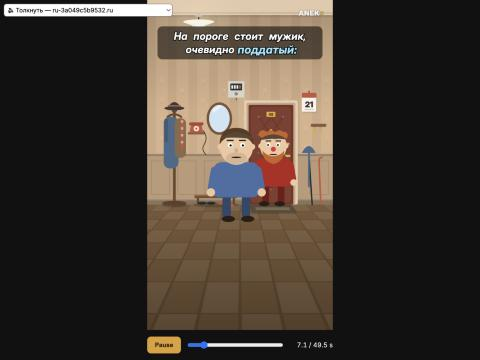

# Этап 7: плеер трека (`@jf/player`) и веб-плеер. Отчёт

План: [docs/ROADMAP.md](../../ROADMAP.md), §7. Справочник: [docs/ENGINE.md](../../ENGINE.md), §11а–11б.

## Сделано
- **Пакет `packages/player` (`@jf/player`)** — чистый TS без React и Remotion:
  - формат `performance.json` и треки — переехали сюда из `remotion/src/perf`;
  - `sample(perf, frame) → FrameState`. Эта функция знает, какая сцена на экране, состояния кукол (бокс, поза, рот, взгляд, предмет в руке, кровать), машины и седоков, лежащие предметы, порядок отрисовки по глубине, камеру, тряску, текущий субтитр и переходы. Раньше эту логику решал проигрыватель Remotion;
  - `audioPlan(perf)` — какие звуки с какого кадра, с какой громкостью и скоростью; `musicGain(perf, frame)` — громкость музыки с проседанием под речью.
- **Арт без Remotion.** Кадр рисует `perf/Frame.tsx` (`FrameView`): `FrameState` → React SVG.
  - Время пропсом теперь берут и субтитры, и переходы, и пролёт над городом. Раньше брали только кукла и массовка.
  - `AbsoluteFill` заменён своим `Fill`.
  - Шрифт: имя семейства в `fonts.ts`, загрузка для Remotion — в `loadFonts.ts`, в вебе — `@font-face`.
  - Из пакета `remotion` арт берёт только чистые `interpolate`/`Easing` (`lib/anim.ts`), чтобы числа совпадали бит в бит. Хуков и контекста Remotion в арте нет.
- **Обёртки:**
  - **Remotion** (`perf/Play.tsx`, 25 строк): кадр видео → `sample` → `FrameView`, звук — по `audioPlan`;
  - **веб** (`remotion/src/web/`): страница с выбором эпизода, пуск/пауза, перемотка, стрелки по кадру. Часы — `requestAnimationFrame` по `AudioContext`, звук — WebAudio (озвучка, смех в конце, закадровый смех с затуханием, музыка с проседанием). Звуки загружаются и раскодируются заранее, пуск без задержки. Годится для браузера, Tauri и мобильного webview.
- **`pnpm player`** — локальный веб-плеер на http://localhost:4173/?id=<эпизод>:
  - сборка esbuild'ом (1,4 МБ: React, арт, данные мест и кукол);
  - исполнение компилируется на лету;
  - звук и шрифт берутся из `remotion/public`.

  `esbuild` взят из локального хранилища pnpm (он уже был в зависимостях Remotion), без скачивания.

## Проверка
- **Видео не изменилось.** `pnpm golden:docker` — 24 из 24. По пикселям: 332 из 408 кадров бит в бит, остальные — растеризационный шум. Единственный кадр с заметной разницей (19 пикселей) отличался от эталона и на коде этапа 4.
- **Веб-плеер** проверен во встроенном браузере на «Толкнуть» (озвученный, 4 сцены) и «Три унитаза»:
  - кадры на глаз такие же, как в видео (попиксельно не сравнивал: другой масштаб);
  - субтитры подсвечивают слова по таймингам;
  - сцены сменяются вовремя, часы идут в реальном времени;
  - озвучка, смех и шрифт загружаются (200), ошибок в консоли нет.

  Сам звук на слух я не проверял: встроенный браузер его не выводит.
- `pnpm typecheck` (все пакеты, включая `@jf/player`), `pnpm validate` — 0 ошибок, `pnpm compile-episode --check` — без расхождений.

## Осталось по этапу 7
- **`pnpm export-art`:** растеризовать слои фонов (`back`/`front`) каждой сублокации и языка в атлас PNG/SVG с метаданными (метки, сиденья, поверхности, передний слой).
- **Display list кукол** из данных гардероба (этап 4) — общий для SVG и Pixi.
- **Обёртка Pixi** для игры.
- Упаковка веб-плеера в Tauri или мобильное приложение — по необходимости. Сейчас это обычная страница.
