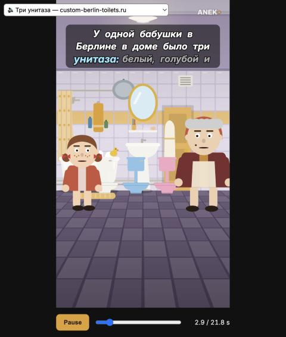
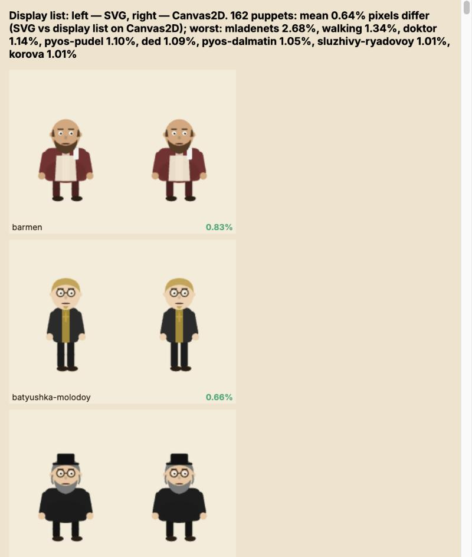
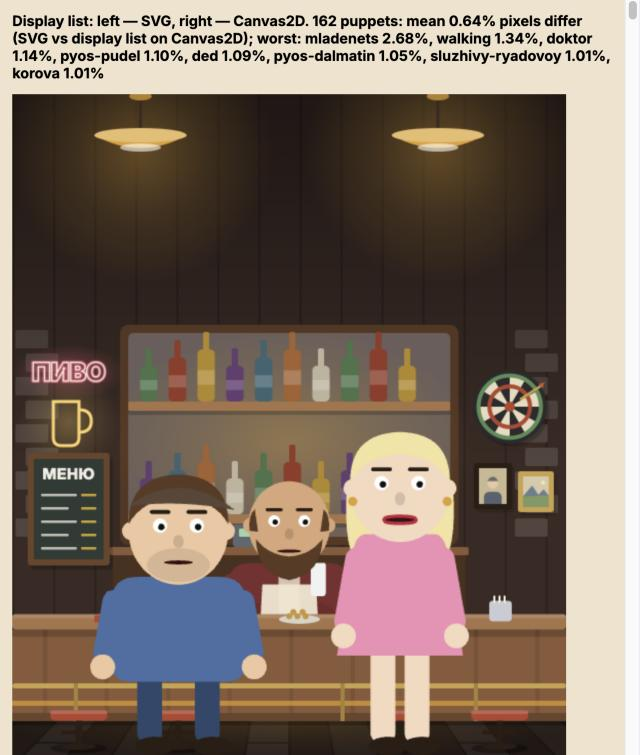

# Этап 7: плеер трека (`@jf/player`) и веб-плеер. Отчёт

План: [docs/ROADMAP.md](../../ROADMAP.md), §7. Справочник: [docs/ENGINE.md](../../ENGINE.md), §11а–11б.

## Сделано
- **Пакет `packages/player` (`@jf/player`)** — чистый TS без React и Remotion:
  - формат `performance.json` и треки — переехали сюда из `remotion/src/perf`;
  - `sample(perf, frame) → FrameState`. Эта функция знает, какая сцена на экране, состояния кукол (бокс, поза, рот, взгляд, предмет в руке, кровать), машины и седоков, лежащие предметы, порядок отрисовки по глубине, камеру, тряску, текущий субтитр и переходы. Раньше эту логику решал проигрыватель Remotion;
  - `audioPlan(perf)` — какие звуки с какого кадра, с какой громкостью и скоростью; `musicGain(perf, frame)` — громкость музыки с проседанием под речью.
- **Арт без Remotion.** Кадр рисует `perf/Frame.tsx` (`FrameView`): `FrameState` → React SVG.
  - Время пропсом теперь берут и субтитры, и переходы, и пролёт над городом. Раньше брали только кукла и массовка.
  - `AbsoluteFill` заменён своим `Fill`.
  - Шрифт: имя семейства в `fonts.ts`, загрузка для Remotion — в `loadFonts.ts`, в вебе — `@font-face`.
  - Из пакета `remotion` арт берёт только чистые `interpolate`/`Easing` (`lib/anim.ts`), чтобы числа совпадали бит в бит. Хуков и контекста Remotion в арте нет.
- **Обёртки:**
  - **Remotion** (`perf/Play.tsx`, 25 строк): кадр видео → `sample` → `FrameView`, звук — по `audioPlan`;
  - **веб** (`remotion/src/web/`): страница с выбором эпизода, пуск/пауза, перемотка, стрелки по кадру. Часы — `requestAnimationFrame` по `AudioContext`, звук — WebAudio (озвучка, смех в конце, закадровый смех с затуханием, музыка с проседанием). Звуки загружаются и раскодируются заранее, пуск без задержки. Годится для браузера, Tauri и мобильного webview.
- **`pnpm player`** — локальный веб-плеер на http://localhost:4173/?id=<эпизод>:
  - сборка esbuild'ом (1,4 МБ: React, арт, данные мест и кукол);
  - исполнение компилируется на лету;
  - звук и шрифт берутся из `remotion/public`.

  `esbuild` взят из локального хранилища pnpm (он уже был в зависимостях Remotion), без скачивания.

## Проверка
- **Видео не изменилось.** `pnpm golden:docker` — 24 из 24. По пикселям: 332 из 408 кадров бит в бит, остальные — растеризационный шум. Единственный кадр с заметной разницей (19 пикселей) отличался от эталона и на коде этапа 4.
- **Веб-плеер** проверен во встроенном браузере на «Толкнуть» (озвученный, 4 сцены) и «Три унитаза»:
  - кадры на глаз такие же, как в видео (попиксельно не сравнивал: другой масштаб);
  - субтитры подсвечивают слова по таймингам;
  - сцены сменяются вовремя, часы идут в реальном времени;
  - озвучка, смех и шрифт загружаются (200), ошибок в консоли нет.

  Сам звук на слух я не проверял: встроенный браузер его не выводит.
- `pnpm typecheck` (все пакеты, включая `@jf/player`), `pnpm validate` — 0 ошибок, `pnpm compile-episode --check` — без расхождений.

## Часть 2: арт для игры
- **Display list** (`remotion/src/art/displayList.ts`). Тот же React SVG (кукла с гардеробом, позой, лицом; предметы) рендерится в разметку и «сплющивается» в плоский список:
  - каждая фигура (path, rect, circle, ellipse, line, polygon) — строка пути SVG `d` с одной матрицей;
  - заливка, обводка и прозрачность — в каждом элементе;
  - одежда по контуру тела — клип путём;
  - помада (в SVG — фильтр) — обводка формы рта цветом губ.

  Кукла — 27–67 элементов, 2–10 мс. Строку пути понимают Path2D (Canvas) и Pixi Graphics.
- **Рендерер Canvas2D** (`art/canvas.ts`, 40 строк) — тот же набор операций, что нужен Pixi: путь в матрице, клип, текст.
- **Проверка** — страница `/art` веб-плеера: 162 случая (все 37 кукол, все 109 вещей и причёсок гардероба, позы: руки вверх, удар, объятие, плач, речь, сидя, в кровати, ходьба). Слева SVG, справа Canvas2D из display list, разница считается в браузере:
  - в среднем расходится **0,64 %** пикселей (сильнее 64 из 255) — сглаживание краёв;
  - больше всего — 2,7 % у младенца: он маленький, у него доля краёв выше;
  - на глаз одинаково.
- **`pnpm export-art [--png] [--locale] [--only]`** → `out/art/`:
  - **фоны** — 68 видов (места и сублокации), 261 слой SVG на трёх языках (5,9 МБ); с `--png` — 261 PNG 1080×1920 за 2,6 минуты (вместе с SVG 83 МБ в `out/art`, в git не попадает), передний слой прозрачен вокруг стойки;
  - **`backdrops/index.json`** — всё, чтобы ставить кукол на фон в игре: метки (x в px, план, линия стоп, масштаб и высота куклы, верх сиденья), поверхности (высота столешницы в px), передний слой, слоты, массовка;
  - **`puppets/*.json`** — display list каждой куклы в покое. В игре его строят на каждый кадр из позы той же функцией.
- **Сцена «как в игре»** (`/art?scene`) — бар только из выгрузки, без React SVG:
  1. фон PNG;
  2. бармен из display list на метке `behind-counter`;
  3. передний слой PNG — стойка закрывает его по пояс, как в видео;
  4. гости перед стойкой.

  В демо куклы в покое, поэтому гости на табуретах стоят, а не сидят. Позу для игры дадут `sample` и `displayListOf`.
- Общий рисунок фона вынесен в `backdropElement` (`components/Background.tsx`): видео и выгрузка рисуют одно и то же.

## Осталось
- **Обёртка Pixi** — когда начнём игру: нужен пакет `pixi.js` (я его не ставил, это скачивание). Display list и рендерер Canvas2D — готовый образец её операций.
- Группа с прозрачностью в display list даёт прозрачность каждому элементу отдельно. Где фигуры внутри такой группы перекрываются, края чуть темнее, чем в SVG. В куклах это почти не встречается: стул под `act sit` появляется плавно.
- SVG-фоны с текстом используют шрифт Inter: в игре его нужно загрузить (PNG уже с текстом).
- Упаковка веб-плеера в Tauri или мобильное приложение — по необходимости.
