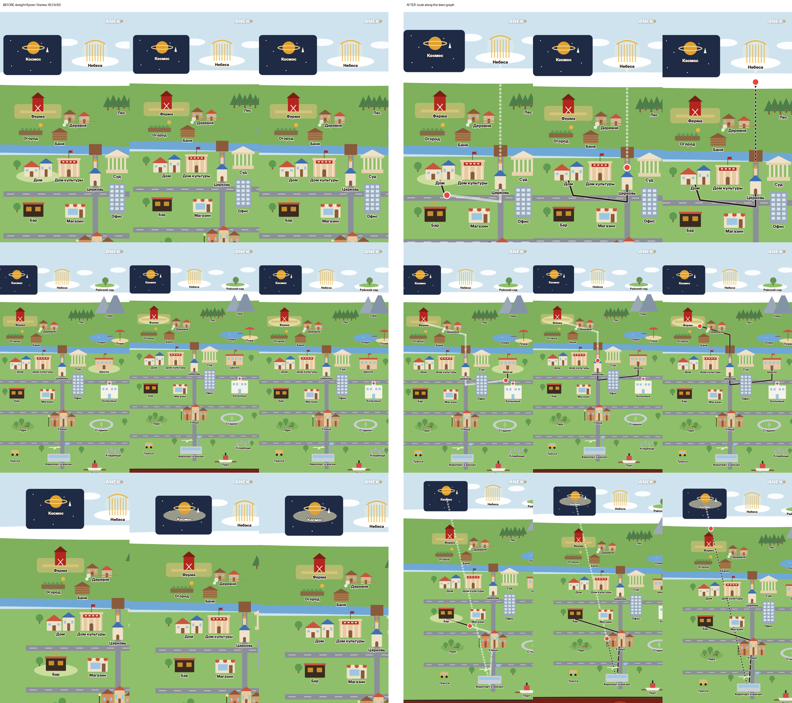

# Этап 8 — мир: канон, журнал, граф городка

## Что сделано
- **Схемы** (`packages/core`): `Canon`, `WorldState`, `TownGraph` и чистые функции `shortestRoute`, `nodeForPlace`, `residentFor`, `castConflicts`, `activeFacts`.
- **`content/world/canon.json`**:
  - 7 районов: центр, кварталы ru/en/de (с языком), Заречье, окраина, тот свет.
  - 41 житель, у каждой из 37 кукол есть хотя бы один. Имена на трёх языках: Вася / Joe / Horst, Люся / Linda / Gabi, Петрович / Pete / Pit… У каждого жителя есть дом и работа, роли, характер и повторяющиеся шутки.
  - Семья живёт в квартале языка эпизода (`district: "home"`): Вася и Люся, старший сын Костя, дочь Алёна, Вовочка, Катя, малыш Тёма, тёща Зинаида Петровна, кот Барсик, домовой Фомич. Дед Матвей живёт в Заречье.
  - 38 связей и 10 ориентиров: бар «У Петровича», поликлиника, отделение, ферма Рыжего, райские врата…
- **`content/world/state.json`** — журнал фактов, пока пустой. Факт отменяется новым фактом с `undoes`, который может ссылаться только на более ранний факт.
- **`content/world/map.json`** — граф из 35 узлов (28 зданий плюс улицы кварталов, Главная улица, мост, кольцевая) и 38 рёбер. Рёбра бывают разных видов: улица, мост, дорога, автобус, лодка, самолёт, небо, подземелье. У каждого ребра есть время в минутах.
- **`pnpm world check`** проверяет:
  - ссылки на кукол, места и комнаты, узлы и жителей;
  - что одна пара «кукла + роль» принадлежит одному жителю;
  - что каждое здание `town.json` есть в графе и граф связен;
  - журнал фактов.

  Проверка входит в `pnpm validate`.
- **`pnpm world cast` (= `pnpm canon-cast`)** детерминированно сопоставляет роль в эпизоде жителю и показывает конфликты.
- **`pnpm world route <a> <b>`** выдаёт путь и время.
- **Пролёт по графу.** Камера охватывает кратчайший маршрут, по нему бежит метка. По земле линия сплошная, у транспорта пунктир, по небу и на самолёте — точки. Это работает и в сборниках, и в переходе `flyover` внутри эпизода. Для проверки есть композиция `Flyover`.

## До и после
Слева старый прямой пролёт, справа новый, по графу. Ряды: дом → небеса, школа → ферма, бар → космос. Кадры 18, 24 и 30 из 48.

- Дом → небеса: русская улица → английская улица → церковь → по небу (12 мин).
- Школа → ферма: улицы → мост → дорога Заречья (26 мин).
- Бар → космос: Главная улица → автобусом в аэропорт → самолётом (72 мин).

## Роли → жители (1805 эпизодов, 4233 слота)
- 3595 слотов (85%) сопоставлены по роли, 638 получили основного жителя куклы, ни один слот не остался без жителя.
- 36 эпизодов с конфликтом. Пример: в `de-witze-1pqtarg.de` учитель — Костя (кукла `paren`), но в каноне он не учитель Вовочки. Такие анекдоты в сериал не идут или получают другого жителя.
- Самые занятые жители: Вася 1077, Костя 427, Люся 397, Коля 214, доктор Семёнов 210.
- Чаще всего уходят на основного жителя: `devochka/child` 40, `muzhik-sosed/everyman` 33, `paren/everyman` 31. Это нормально: «обычный человек» в роли соседа — это и есть Коля.

## Проверки
- `pnpm typecheck` — ок.
- `pnpm validate` — 1805 эпизодов, 0 ошибок; мир — 0 ошибок, 0 предупреждений.
- Журнал проверен на тестовом файле: ссылка `undoes` вперёд, неизвестный житель и неизвестная комната ловятся. Тестовый файл удалён.
- `pnpm compile-episode --debug --check` — ок.
- `pnpm golden:docker` — 24 эпизода, 0 изменений. В отладочном наборе нет пролётов, поэтому новый пролёт проверен кадрами выше.

## Что не сделано
- Противоречия журнала с эпизодами («машина разбита» → нельзя ехать до «починил») требуют фактов из серий. Эту проверку делаем вместе со сценаристом связок на этапе 9. Сейчас проверяются только ссылки, `undoes` и дубли действующих фактов.
- Канон пока не попадает в `context.md` писателей. Он понадобится сценаристу серий на этапе 9.
