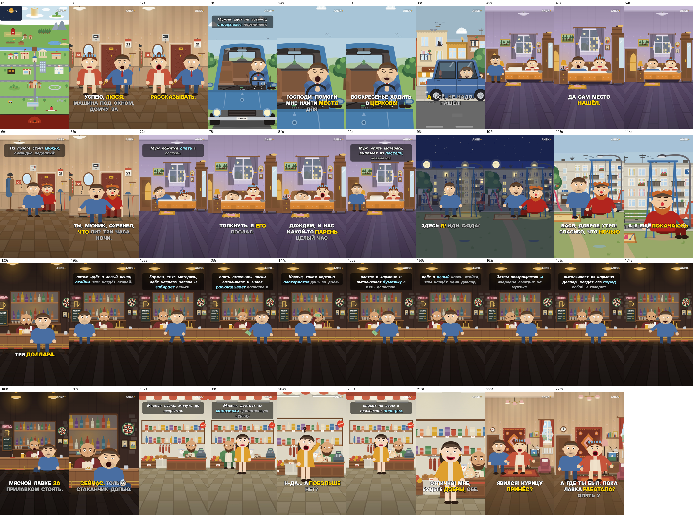

# Этап 9 — сериал: готовые анекдоты + связки

## Что сделано
- **Схемы** (`packages/core`):
  - `Series` — арка, части по порядку, состав «житель → кукла», изменения мира, `accepted`;
  - `SeriesDraft` и `BridgeDraft` — ответ LLM;
  - `StateChange` — изменение мира.
- **Подбор анекдотов — код**, без LLM (`pnpm series pick --locale ru [--n 4] [--voiced]`). Анекдоты берутся:
  - языка серии;
  - без флагов публикации;
  - ещё не вошедшие в серии.

  В наборе:
  - у каждой куклы один житель канона;
  - у анекдотов разные места;
  - каждый анекдот делит с остальными хотя бы одного жителя.

  Порядок — от самых популярных. Всего сейчас можно собрать **137 ru, 146 en и 142 de серий** по 4 анекдота.
- **LLM-стадия `series`** (`pipeline/prompts/series.md`).
  - Вход:
    - анекдоты набора: места, кто кем, суть, первая и последняя реплика;
    - фиксированный состав;
    - выжимка канона;
    - действующие факты.
  - Выход: арка, 2–6 связок и 0–3 изменения мира.
  - Проверки связок:
    - связка проходит все проверки сценария: куклы, места, метки, костюмы, сцены, линтер. Для этого проверки и сборка вынесены в общий модуль `pipeline/src/drafts.ts`. Пересборка всех 1800 эпизодов после выноса даёт ноль отличий;
    - есть открывающая и закрывающая связки;
    - куклы связок играют тех же жителей, что и в анекдотах;
    - `undoes` ссылается только на действующий факт.
- **Сборка** (`pnpm llm materialize series`):
  - `content/series/<id>.json`;
  - связки `content/episodes/<id>.bN.json` (эпизоды `kind: "bridge"`);
  - сборник `content/compilations/<id>.json`.

  Дальше работает всё, что уже есть: рендер `pnpm render --compilation <id>` с пролётами по графу, озвучка связок `pnpm voice run --compilation <id>`, compile, validate.
- Связки не попадают в `pnpm db sync` и автопостинг как отдельные ролики.
- **`pnpm series check`** (входит в `pnpm validate`):
  - части существуют и нужного вида;
  - анекдот входит только в одну серию;
  - состав совпадает с каноном;
  - сборник совпадает с частями;
  - у принятой серии факты есть в журнале.
- **`pnpm series accept <id>`** записывает изменения мира в `content/world/state.json`. Следующие серии получают эти факты на вход.

## Пилот: 2 русские серии из озвученных анекдотов
**«Васины сутки»** (`ru-s40012a1a`): связка «Утро» → «Парковка» → «Отбой» → «Толкнуть» → «Наутро» → «Сдача» → «Закрываемся» → «Курица» → «Без курицы». Длина 3:53.
- Арка: Люся велела купить курицу, ночью Рыжий Фёдор поднял Васю, днём Вася засиделся у Петровича, а последних кур забрала Даша.
- Факты после серии:
  - Петрович по вечерам стоит в мясной лавке;
  - Фёдор облюбовал качели во дворе;
  - Люся всё ещё ждёт курицу.

**«Деньги знаешь где»** (`ru-s6a0f323f`): «Песня по заявке» → «Сходить» → «Чей телефон?» → «Штраф».
- Арка: Палыч в бане отвечает по Васиному телефону и разрешает Люсе шубу. Вася обзывает его пнём и попадает к нему же под суд. Тёща ставит Палыча в пример.

Кадры «Васиных суток» каждые 6 секунд. Связки идут без голоса, только с субтитрами: платную озвучку не трогал.

## Цена
- **Пилот:** один агент на 2 серии, ~190 тыс. токенов. Это ~95 тыс. на серию, больше оценки в ROADMAP (30–40 тыс.): агент читает script.md и context.md целиком. При 5 серий на агента ожидаю ~50–60 тыс. на серию.
- **Полный прогон:** ~425 серий (ru/en/de) ≈ 21–25 млн токенов. Запускаю только после «да».
- **Озвучка связок:** в пилоте 1777 знаков на 2 серии (~900 на серию). На все серии — ~380 тыс. знаков. Платная, только с согласия.

## Проверки
- `pnpm typecheck` — ок.
- `pnpm validate` — 1815 эпизодов (включая 10 связок), 0 ошибок; серии — 0 проблем.
- `pnpm compile-episode --debug --check` — ок.
- `pnpm golden:docker` — 24 эпизода, 0 изменений.

## Что дальше / не сделано
- Обе пилотные серии **не приняты**: факты не записаны в журнал. Принять, когда факты понравятся: `pnpm series accept <id>`.
- Связки без голоса. Озвучка: `pnpm voice run --compilation ru-s40012a1a`, ~900 знаков на серию, только с согласия.
- Противоречия журнала проверяются по ссылкам и `undoes`. Смысловые противоречия («машина разбита» → едет) сейчас отсекает промпт: LLM получает действующие факты. Правило в коде добавим, когда в журнале накопятся факты.
